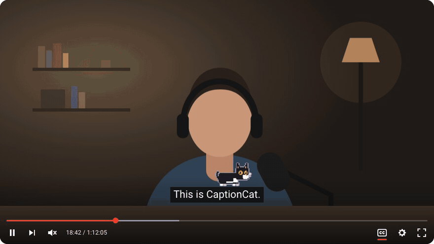

<h3>一只住在 YouTube 字幕上的像素小猫</h3>

听播客、看讲座、刷长视频，它都在旁边。

[English](README.md) · **简体中文**

[添加到 Chrome](https://chromewebstore.google.com/detail/eoeieepckdlahakhfdipjmijbglipnom?hl=zh-CN&utm_source=github) · [官网](https://captioncat.app/zh/) · [观看演示](https://www.youtube.com/watch?v=DTOXzpS6HF8) · [隐私政策](https://captioncat.app/zh/privacy) · [反馈问题](https://github.com/loethen/captioncat/issues)

## 为什么是一只猫？

我在 YouTube 上听英文播客学英语，一期一两个小时，画面里没什么可看的。于是在字幕上放了一只猫。

它在字幕上走来走去，会把东西推下去，视频太长就睡着了。听到 cute 会冒爱心，听到 fish 会馋。

## 看看它的样子

想听声音？[去 YouTube 看演示](https://www.youtube.com/watch?v=DTOXzpS6HF8)。

## 安装

| 浏览器 | 获取方式 |
| --- | --- |
| Chrome | [Chrome 网上应用店](https://chromewebstore.google.com/detail/eoeieepckdlahakhfdipjmijbglipnom?hl=zh-CN&utm_source=github) |
| Edge | 从 [Chrome 网上应用店](https://chromewebstore.google.com/detail/eoeieepckdlahakhfdipjmijbglipnom?hl=zh-CN&utm_source=github)安装，Edge 支持 Chrome 插件 |

支持 Chromium 120 及以上版本。界面提供简体中文和英文。

## 功能

### 🐈‍⬛ 陪着你的猫

一只像素奶牛猫住在 YouTube 正在显示的字幕上。它在字幕上踱步、伸懒腰、打喷嚏、钻纸箱、把杯子推下去，视频太长就睡着了。它还会对字幕里的话做出反应：听到「cute」冒出爱心，听到「wow」瞪大眼睛，有人提到鱼就馋了。你可以挑它平时做哪些动作、调它的活跃程度，也可以把它关掉。全屏时它也在。

### 📄 纸片字幕

给字幕加了个白底，画面再乱也不晃眼。字体和大小沿用你在 YouTube 里的设置。按 <kbd>Alt</kbd> + <kbd>Shift</kbd> + <kbd>S</kbd> 能随时切回原版。

### 🌐 悬停翻译

鼠标放上去就能看整句翻译，视频也会跟着暂停，等你看完再继续。支持十六种目标语言。默认关闭，在设置里打开。

### 📒 点词收藏

碰到不认识的词，点一下就存好了。自带原来的例句，按视频分得明明白白。可以搜索单词本、一键复制复习提示词交给 AI，或者导出 JSON。目前支持英文字幕。默认关闭，在设置里打开。

### 🔒 数据留在你身边

没有账号，不做统计，不做追踪。设置和收藏的单词都只存在你的浏览器里。唯一会离开你电脑的，是开启悬停翻译后你鼠标停留的那一句字幕，它会发送给 Google 翻译。详见[隐私政策](https://captioncat.app/zh/privacy)。

## 反馈

发现问题或者有想法？欢迎[提交 issue](https://github.com/loethen/captioncat/issues)，或写信到 [contact@captioncat.app](mailto:contact@captioncat.app)。如果字幕猫陪过你，给这个仓库点个 ⭐，能帮更多学外语的人发现它。

欢迎贡献代码，先看看[开发指南](docs/development.md)。提交贡献即表示你同意，你的贡献按 MIT 协议授权。

## 许可协议

[MIT](LICENSE)。

小猫的原型来自「警花」，我家的奶牛猫。🐾
